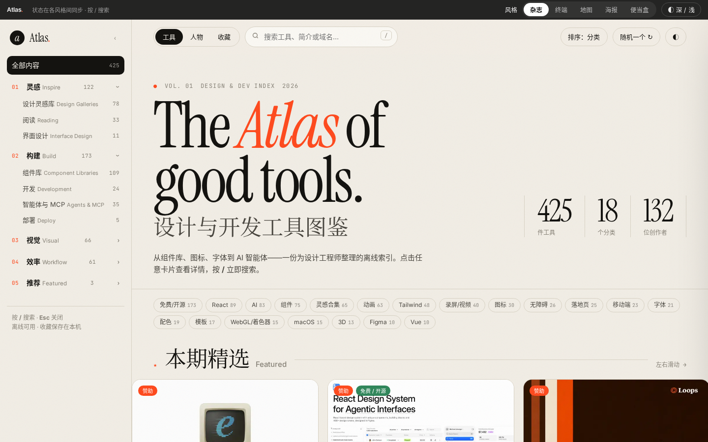
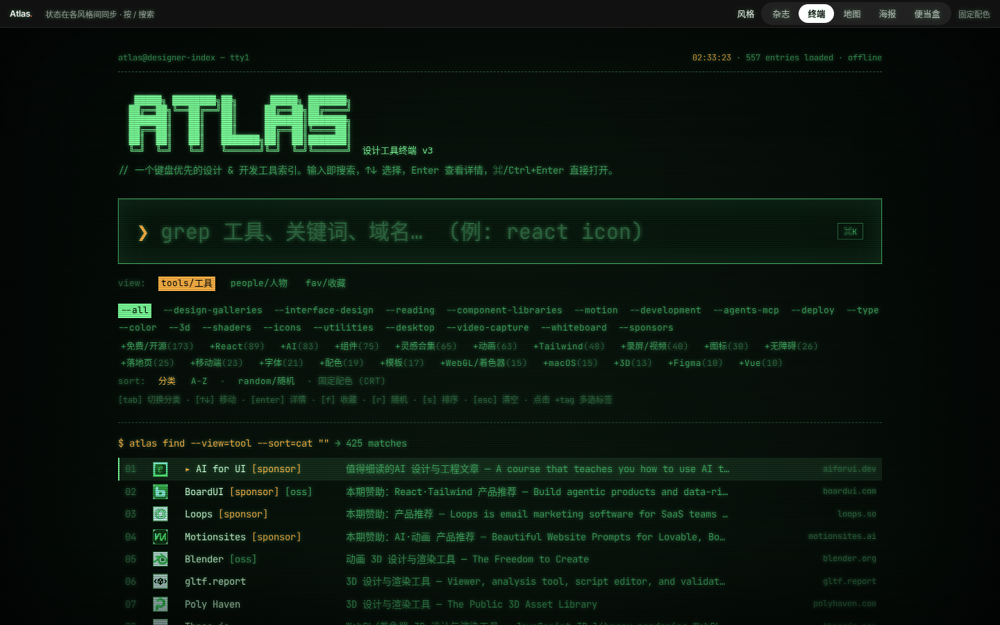
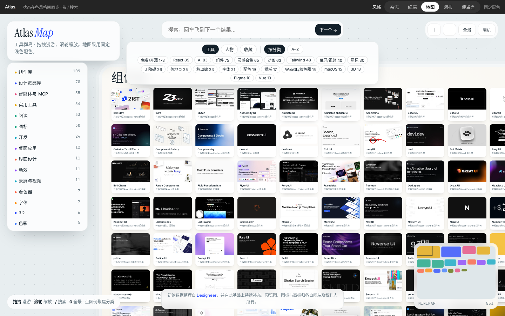
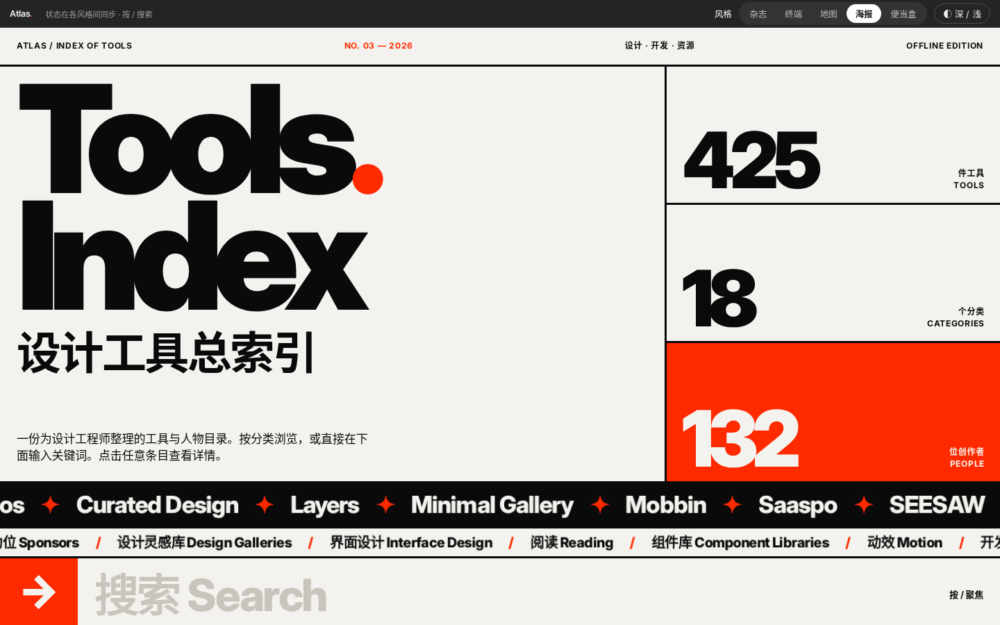
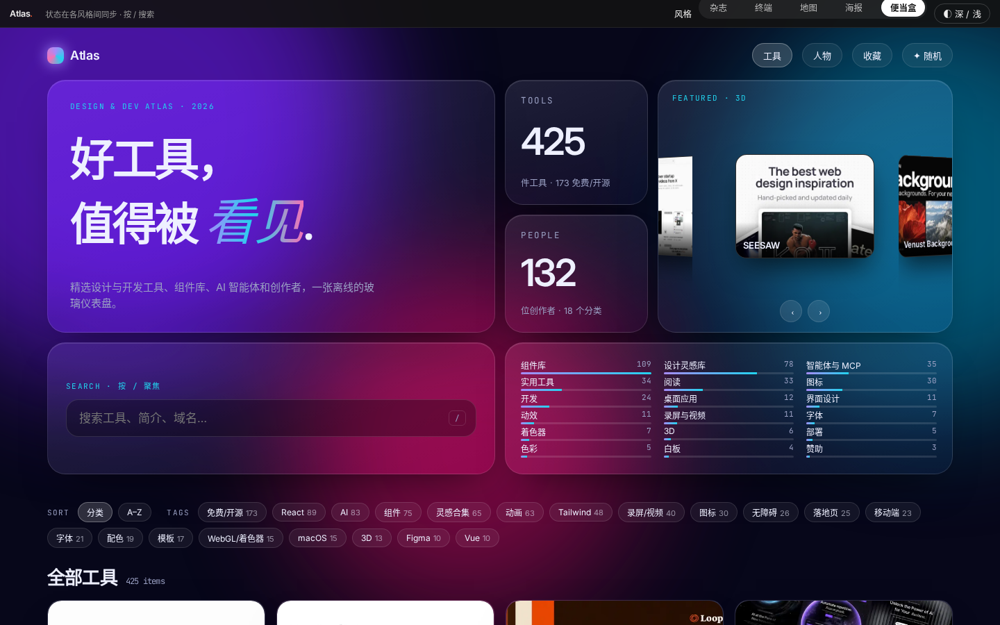

# Atlas · 设计与开发工具图鉴

**在线访问：** [https://ocean1798.github.io/design-atlas/](https://ocean1798.github.io/design-atlas/)


一个完全离线、无需构建的设计与开发工具索引：收录 425 个工具与 132 位值得关注的设计师 / 工程师，并提供五种风格完全不同的浏览界面。所有风格共享同一份数据、收藏与筛选状态，可随时在右上角切换。

> 初始数据整理自 [Designeer](https://designeer.xyz)，并在此基础上持续补充。

## 五种风格

| 风格 | 说明 |
| --- | --- |
| **杂志** `magazine.html` | 编辑杂志风：大号衬线标题、精选横滑、按分类的错落网格，两级侧栏导航，支持深 / 浅色。 |
| **终端** `terminal.html` | 绿色 CRT 命令行：大号搜索框，结果像 CLI 一样逐行输出，键盘优先（↑↓ / Enter / Tab / ⌘K）。固定配色。 |
| **地图** `canvas.html` | 无限画布：工具按分类聚成“岛屿”，可拖拽、缩放，带小地图与“飞到下一个结果”。固定配色。 |
| **海报** `swiss.html` | 瑞士海报 / 粗野主义：超大字号、色块分类、滚动字幕，黑白 + 一种红色，支持深 / 浅色。 |
| **便当盒** `bento.html` | 玻璃拟态仪表盘：极光背景、3D 旋转精选卡片、悬停倾斜卡片，支持深 / 浅色。 |







所有风格都支持：分类筛选、多选标签、排序（分类 / A–Z）、工具 / 人物 / 收藏 标签页、收藏（保存在浏览器本地）、随机推荐、详情抽屉（打开 / 复制链接）、按 `/` 聚焦搜索、图片懒加载。

## 本地打开

无需安装任何依赖，也不依赖任何 CDN：

1. 下载或克隆本仓库；
2. 直接双击 `index.html`（会自动进入上次使用的风格，首次为“杂志”）。

也可以用任意静态服务器预览，例如 `python3 -m http.server`，然后访问 `http://localhost:8000/`。

## 目录结构

```
index.html          入口（记住上次的风格）
magazine.html …     五种风格页面
data.js             共享数据
common.js           共享状态、风格切换、详情抽屉
assets/             预览图、站点图标与字体（Instrument Serif / Inter / JetBrains Mono，SIL OFL）
screenshots/        README 截图
```

## 版权与说明

- 初始数据整理自 [Designeer](https://designeer.xyz)，并在此基础上持续补充。本站界面与代码为独立原创设计。
- 收录的工具名称、预览图（来自各站点公开的 og:image）、图标与商标均归各自网站及权利人所有，仅用于索引与介绍。
- 如果你是相关权利人并希望修改或移除某个条目或图片，欢迎通过 [Issues](../../issues) 提出，我们会尽快处理。
